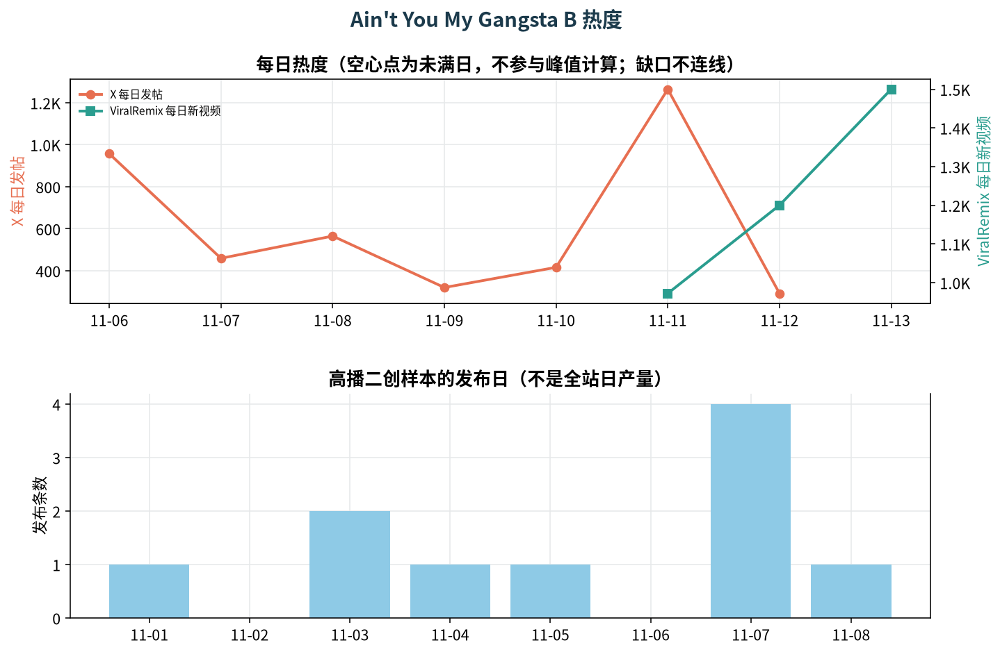

# AI 视频梗日报 2026-11-13

只回答一件事：今天该为哪个梗做 AI 模板。

## 一、总排名

| 排名 | 梗 | 综合评分 | 结论 | 窗口期 | 已火天数 | 高峰状态 |
|---|---|---|---|---|---|---|
| 1 | [Ain't You My Gangsta B（视频通话问答「Yes!」）](#meme-aint-you-my-gangsta) | 65（热9 趋17 分12 竞14 窗13） | 做 | 约 3–5 天，趁日榜还在爬坡 | 15 天 | 上升中（峰值 11-13 的 1500） |
| 2 | [Cat on Ultra Bee（猫骑越野车）](#meme-cat-ultra-bee) | 61（热10 趋9 分16 竞15 窗11） | 观望 | 约 2–4 天，跟宠物页一起，不单独压 | 8 天 | 没有全站日序列，不判断 |
| 3 | [Kitten Parade Meme（小猫游行）](#meme-kitten-parade) | 60（热9 趋14 分13 竞11 窗13） | 观望 | 约 3–5 天，先观察 11/14 日榜 | 8 天 | 数据不足（可用点 1 个） |
| 4 | [You Never Let Her Pay（从不让她付钱（海绵钱包）） 【早期信号】](#meme-you-never-let-her-pay) | 58（热11 趋8 分6 竞17 窗16） | 观望 | 约 5–7 天，适合先做轻量页 | 3 天 | 回落 98%（峰值 11-08 的 42 → 11-12 的 1） |
| 5 | [Waist Heart Trend（腰间比心）](#meme-waist-heart) | 57（热9 趋16 分6 竞13 窗13） | 观望 | 约 3–5 天，挂在 Bicep Heart 页做变体 | 10 天 | 上升中（峰值 11-12 的 770） |
| 6 | [Bicep Heart（二头肌比心）](#meme-bicep-heart) | 54（热17 趋5 分13 竞12 窗7） | 观望 | 约 1–3 天，只做变体 | 14 天 | 回落 19%（峰值 11-04 的 17138 → 11-12 的 13961） |
| 7 | [Deck the Halls Dance（Deck the Halls 圣诞舞） 【早期信号】](#meme-deck-the-halls) | 53（热10 趋10 分6 竞10 窗17） | 观望 | 圣诞前数周，但先做通用节日舞 | 10 天 | 没有全站日序列，不判断 |
| 8 | [Dog Grooming Time（宠物美容反客为主） 【早期信号】](#meme-dog-grooming-time) | 53（热9 趋8 分6 竞15 窗15） | 观望 | 约 4–6 天 | 5 天 | 峰值（峰值 11-12 的 0） |
| 9 | [Shaking Head（宠物摇头） 【早期信号】](#meme-shaking-head) | 53（热6 趋6 分16 竞16 窗9） | 观望 | 作为宠物页配菜，约 2–3 天 | 25 天 | 回落 20%（峰值 11-09 的 486 → 11-12 的 390） |
| 10 | [Shoulder Carry（I'm the One 扛肩翻身）](#meme-shoulder-carry) | 51（热14 趋3 分10 竞16 窗8） | 观望 | 约 1–2 天，只维护已有双人页 | 114 天 | 回落 46%（峰值 11-09 的 27600 → 11-13 的 14800） |
| 11 | [Pimpwalk Entrance（Pimpwalk 进场） 【早期信号】](#meme-pimpwalk) | 50（热5 趋12 分13 竞11 窗9） | 观望 | 约 2–3 天，先看 11/14 是否回到日榜 | 27 天 | 上升中（峰值 11-12 的 120） |
| 12 | [#lastchristmas（圣诞情侣怀旧短片） 【TikTok Top100·CA,DE,GB,US】](#meme-lastchristmas) | 49（热12 趋3 分6 竞14 窗14） | 观望 | 圣诞前仍有数周，但标签在退 | 23 天 | 回落 20%（峰值 11-06 的 100.1 → 11-10 的 79.9） |
| 13 | [Flamingo Float（火烈鸟泳圈）](#meme-flamingo-float) | 48（热6 趋15 分9 竞9 窗9） | 观望 | 约 2–3 天 | 11 天 | 没有全站日序列，不判断 |
| 14 | [Ba Ba Ba Dance（图书馆双人舞）](#meme-ba-ba-ba) | 47（热19 趋6 分5 竞11 窗6） | 观望 | 只复用双人舞能力 | 42 天 | 回落 22%（峰值 11-02 的 53400 → 11-13 的 41600） |
| 15 | [Careless Whisper Car（车内 Careless Whisper 抢薯片） 【早期信号】](#meme-careless-whisper-car) | 47（热4 趋8 分6 竞17 窗12） | 观望 | 先观察 48 小时 | 未核实 | 回落 50%（峰值 11-10 的 8 → 11-12 的 4） |
| 16 | [Grinch Pet Filter（宠物变格林奇）](#skip-table) | 47（热13 趋3 分13 竞4 窗14） | 不做（按分数应为观望，否决：（原日报未单列推翻理由，以下为当日记录的结论理由）宠物变格林奇：ViralRemix 11/12 新上第 4（12,700 条/日）→ 11/13 6,500（-49%，Past peak）【第三方读数】；模板约 10,500 次/日（站方转述）【第三方读数】。格林奇是未授权影视/绘本 IP，按格式否决不做；若要蹭季节，做通用「宠物变圣诞小怪」。） | 圣诞季长，但 IP 否决 | 10 天 | 回落 49%（峰值 11-12 的 12700 → 11-13 的 6500） |
| 17 | [Santa Nice List（圣诞老人好孩子名单）](#meme-santa-nice-list) | 46（热7 趋5 分6 竞13 窗15） | 观望 | 圣诞前数周 | 8 天 | 回落 30%（峰值 11-12 的 986 → 11-13 的 694） |
| 18 | [Talk To Me Doja（Talk To Me Doja 捧脸摇） 【早期信号】](#skip-table) | 45（热5 趋14 分13 竞5 窗8） | 不做（按分数应为观望，否决：（原日报未单列推翻理由，以下为当日记录的结论理由）11/13 首次上 ViralRemix 日榜（第 41，215 条/日）【第三方读数】，X 11/11 单日 395 帖跳升【已核实】，二创中位 1.93%（n=10）【已核实】。但核心是贴《山田君与七人魔女》动漫角色 GIF + Doja Cat 歌，本质是真人跟跳 + 未授权动漫素材，按格式/IP 否决。） | IP 否决 | 6 天 | 数据不足（可用点 1 个） |
| 19 | [Rubber Band Prank（弹力带整蛊反弹） 【早期信号】](#meme-rubber-band-prank) | 44（热9 趋7 分6 竞12 窗10） | 观望（按分数应为不做，否决：（原日报未单列推翻理由，以下为当日记录的结论理由）CapCut AI 模板（1 张照片 → 弹力带反弹打脸），Turnly 62、Remake the Trend 82→63 个周创作者，不再标 New/Hot【第三方读数】。基数不大的早期信号，周检在降、没有日序列和二创样本，只观望。） | 约 2–3 天，低优先 | 7 天 | 峰值（峰值 11-12 的 0） |
| 20 | [Y Entiende Corazón Trend（Y Entiende Corazón 对口型） 【TikTok Top100·DE,FR,US】](#skip-table) | 44（热16 趋6 分6 竞8 窗8） | 不做 | 已过加速段 | 21 天 | 回落 26%（峰值 11-11 的 34300 → 11-13 的 25300） |
| 21 | [Pet Rock Dance（宠物摇滚头锤） 【早期信号】](#meme-pet-rock) | 43（热6 趋5 分16 竞8 窗8） | 观望（按分数应为不做，否决：（原日报未单列推翻理由，以下为当日记录的结论理由）分享率高（中位 2.61%，n=10）【已核实】，但 ViralRemix 737 → 480（-35%）一路下滑【第三方读数】，模板 11/1 已上、首周超 3.5 万次（站方转述）。在回落但仍有分享率，按口径观望；只作为宠物页的一个选项。） | 并进宠物页，不单开 | 12 天 | 回落 35%（峰值 11-10 的 737 → 11-13 的 480） |
| 22 | [Then I Walk In（推门走入） 【早期信号】](#skip-table) | 42（热6 趋5 分10 竞15 窗6） | 不做 | 窗口已过 | 26 天 | 回落 43%（峰值 11-09 的 152 → 11-11 的 86） |
| 23 | [冬日恐悚 / 悬疑反转（学格式，不追比赛标签） 【TikTok Top100·DE,GB,US】](#skip-table) | 42（热10 趋3 分6 竞15 窗8） | 不做 | 学格式，不追比赛标签 | 34 天 | 回落 49%（峰值 10-19 的 100 → 11-07 的 50.9） |
| 24 | [Can I Ride（双人轮流舞）](#skip-table) | 41（热12 趋2 分5 竞17 窗5） | 不做 | 窗口已过 | 35 天 | 回落 64%（峰值 11-08 的 24800 → 11-13 的 8900） |
| 25 | [Malfoid（女版马尔福）](#skip-table) | 37（热18 趋6 分10 竞2 窗1） | 不做 | 不是视频模板需求 | 52 天 | 回落 46%（峰值 11-04 的 66729 → 11-12 的 36243） |
| 26 | [Baby Doll Dance（Babydoll 排舞）](#skip-table) | 34（热12 趋6 分2 竞8 窗6） | 不做 | 真人编舞，不做 | 未核实 | 回落 27%（峰值 11-11 的 7500 → 11-13 的 5500） |
| 27 | [#imsosorry（精修图道歉揭穿） 【TikTok Top100·AU,CA,GB,US】](#skip-table) | 32（热9 趋2 分6 竞11 窗4） | 不做 | 窗口已过 | 28 天 | 回落 50%（峰值 10-20 的 100.1 → 11-10 的 49.8） |
| 28 | [Police Chase AI（AI 警察追逐） 【早期信号】](#skip-table) | 31（热5 趋6 分5 竞9 窗6） | 不做 | 窗口已过 | 12 天 | 回落 20%（峰值 11-10 的 445 → 11-13 的 357） |
| 29 | [#angelofmydreams（Angel of My Dreams） 【TikTok Top100·GB,US】](#skip-table) | 30（热9 趋5 分2 竞10 窗4） | 不做 | 窗口已过 | 32 天 | 回落 23%（峰值 10-22 的 100.1 → 11-10 的 77） |
| 30 | [#housewife（Housewife 舞） 【TikTok Top100·AU,CA,DE,FR,GB,US】](#skip-table) | 29（热9 趋2 分5 竞9 窗4） | 不做 | 窗口已过 | 29 天 | 回落 59%（峰值 10-15 的 100.1 → 11-10 的 40.8） |
| 31 | [Grandpa Fish（切鱼梗）](#skip-table) | 29（热9 趋8 分5 竞4 窗3） | 不做 | CapCut 已铺开 | 10 天 | 没有全站日序列，不判断 |
| 32 | [#damehombro（把肩膀给我（抖肩舞）） 【TikTok Top100·US】](#skip-table) | 28（热8 趋1 分6 竞10 窗3） | 不做 | 窗口已过 | 34 天 | 回落 89%（峰值 10-23 的 100.1 → 11-10 的 10.7） |
| 33 | [Flower Bouquet With Face（花束里的脸） 【早期信号】](#skip-table) | 26（热4 趋3 分6 竞9 窗4） | 不做 | 窗口已过 | 7 天 | 上升中（峰值 11-10 的 1400） |
| 34 | [Turning My Mom Into Me（把妈妈变成我） 【早期信号】](#skip-table) | 22（热4 趋2 分5 竞8 窗3） | 不做 | 窗口已过 | 13 天 | 回落 58%（峰值 11-09 的 135 → 11-11 的 57） |
| 35 | [#halloweentransition（万圣节变装过渡） 【TikTok Top100·AU,CA,DE,GB,US】](#skip-table) | 19（热4 趋0 分6 竞8 窗1） | 不做 | 季节结束 | 35 天 | 回落 100%（峰值 10-30 的 100.1 → 11-10 的 0.4） |

*【已核实】＝从平台公开统计亲自读到；【第三方读数】＝ViralRemix / Turnly / Creative Center 等追踪站；【估算】＝推算值。X 日发帖、ViralRemix 日新视频、Creative Center 指数口径不同，不能横比。*

### 回测

截至 2026-11-13，「做」命中率 0%（对 0 / 错 2，待定 1，数据不足 3，连续推荐不重复计 0）。观望/不做漏判率 0%（漏判 0 / 未漏判 1，待定 34，数据不足 20）。

*规则见 docs/scoring.md：「做」看 D+3 主热度是否严格高于基线，连续推荐只计首日；观望/不做若 D+3 主热度比基线高 20% 以上记为漏判。*

### 今日缺口与说明

- **meme_pack_2026-11-13.json：**11/11、11/12 两次任务未跑完，没有出日报；今天的变动对比的是 11/10。
- **meme_pack_2026-11-13.json：**Creative Center rank_change 全部为空，NEW/fade 只是 7 日 vs 30 日是否上榜的代理。
- **meme_pack_2026-11-13.json：**CC 曲线由画布像素读出（±1），最后一天 11/10；官方比赛标签按规则未拉详情。详情页仍没有兴趣、相关话题、创作者；相关视频只有封面 key。
- **meme_pack_2026-11-13.json：**10 个 Instagram 监控账号需要登录，未覆盖。
- **meme_pack_2026-11-13.json：**Turnly 周检仍停在 11/11；jumponthetrend 停站、MakeViral 域名停放；CapCut 模板页需要 JS，用量都是追踪站转述。
- **meme_pack_2026-11-13.json：**X 只有近 7 日计数；部分短语查询偏吵（Paws At You、Ain't You My Gangsta、Talk To Me Doja、Then I Walk In）。
- **meme_pack_2026-11-13.json：**新梗 You Never Let Her Pay、Dog Grooming Time、Careless Whisper Car、Rubber Band Prank 没有 5 条高播二创样本。
- **watchlist TikTok@mxrender：**No posts found in the last 48h (since 2026-11-11 09:00 HKT) via urlebird public viewer (saw 18 listed videos, pages=1)
- **watchlist TikTok@capcutnewyork：**No posts found in the last 48h (since 2026-11-11 09:00 HKT) via urlebird public viewer (saw 19 listed videos, pages=1)
- **watchlist TikTok@hitpaw：**No posts found in the last 48h (since 2026-11-11 09:00 HKT) via urlebird public viewer (saw 111 listed videos, pages=6)
- **watchlist TikTok@shedoesai：**No posts found in the last 48h (since 2026-11-11 09:00 HKT) via urlebird public viewer (saw 20 listed videos, pages=1)
- **watchlist Instagram@realisticaivid：**needs login; public no-login sources did not yield inspectable posts. instagram.com/realisticaivid/ -> HTTP 200 https://www.instagram.com/accounts/login/?next=https%3A%2F%2Fwww.instagram.com%2Frealisticaivid%2F&is_from_rle login wall / no public media JSON; dumpor.io public viewer presented a bot/captcha check (not bypassed)
- **watchlist Instagram@valentinloiseau.ai：**needs login; public no-login sources did not yield inspectable posts. instagram.com/valentinloiseau.ai/ -> HTTP 200 https://www.instagram.com/valentinloiseau.ai/ login wall / no public media JSON; dumpor.io public viewer presented a bot/captcha check (not bypassed)
- **watchlist TikTok@luca.creates.ai：**No posts found in the last 48h (since 2026-11-11 09:00 HKT) via urlebird public viewer (saw 108 listed videos, pages=6)
- **watchlist TikTok@cringeai_videos：**No posts found in the last 48h (since 2026-11-11 09:00 HKT) via urlebird public viewer (saw 98 listed videos, pages=6)
- **watchlist TikTok@okamana777：**No posts found in the last 48h (since 2026-11-11 09:00 HKT) via urlebird public viewer (saw 21 listed videos, pages=1)
- **watchlist TikTok@trendss.dee：**No posts found in the last 48h (since 2026-11-11 09:00 HKT) via urlebird public viewer (saw 21 listed videos, pages=1)
- **watchlist TikTok@0keemacurry0：**No posts found in the last 48h (since 2026-11-11 09:00 HKT) via urlebird public viewer (saw 21 listed videos, pages=1)
- **watchlist TikTok@llegendmaker：**No posts found in the last 48h (since 2026-11-11 09:00 HKT) via urlebird public viewer (saw 18 listed videos, pages=1)
- **watchlist TikTok@gxoeditz：**No posts found in the last 48h (since 2026-11-11 09:00 HKT) via urlebird public viewer (saw 21 listed videos, pages=1)
- **watchlist Instagram@yapayzekaserisi：**needs login; public no-login sources did not yield inspectable posts. instagram.com/yapayzekaserisi/ -> HTTP 200 https://www.instagram.com/yapayzekaserisi/ login wall / no public media JSON; dumpor.io public viewer presented a bot/captcha check (not bypassed)
- **watchlist Instagram@ai.cosmic：**needs login; public no-login sources did not yield inspectable posts. instagram.com/ai.cosmic/ -> HTTP 200 https://www.instagram.com/ai.cosmic/ login wall / no public media JSON; dumpor.io public viewer presented a bot/captcha check (not bypassed)
- **watchlist Instagram@ifonly.ai：**needs login; public no-login sources did not yield inspectable posts. instagram.com/ifonly.ai/ -> HTTP 200 https://www.instagram.com/accounts/login/?next=https%3A%2F%2Fwww.instagram.com%2Fifonly.ai%2F&is_from_rle login wall / no public media JSON; dumpor.io public viewer presented a bot/captcha check (not bypassed)
- **watchlist Instagram@bellvtrix.ai：**needs login; public no-login sources did not yield inspectable posts. instagram.com/bellvtrix.ai/ -> HTTP 200 https://www.instagram.com/accounts/login/?next=https%3A%2F%2Fwww.instagram.com%2Fbellvtrix.ai%2F&is_from_rle login wall / no public media JSON; dumpor.io public viewer presented a bot/captcha check (not bypassed)
- **watchlist Instagram@lexraym：**needs login; public no-login sources did not yield inspectable posts. instagram.com/lexraym/ -> HTTP 200 https://www.instagram.com/accounts/login/?next=https%3A%2F%2Fwww.instagram.com%2Flexraym%2F&is_from_rle login wall / no public media JSON; dumpor.io public viewer presented a bot/captcha check (not bypassed)
- **watchlist Instagram@pokemon_reimagined_ai：**needs login; public no-login sources did not yield inspectable posts. instagram.com/pokemon_reimagined_ai/ -> HTTP 200 https://www.instagram.com/pokemon_reimagined_ai/ login wall / no public media JSON; dumpor.io public viewer presented a bot/captcha check (not bypassed)
- **watchlist Instagram@igorbabkoff_ai：**needs login; public no-login sources did not yield inspectable posts. instagram.com/igorbabkoff_ai/ -> HTTP 200 https://www.instagram.com/igorbabkoff_ai/ login wall / no public media JSON; dumpor.io public viewer presented a bot/captcha check (not bypassed)
- **watchlist Instagram@rita.pro.ai：**needs login; public no-login sources did not yield inspectable posts. instagram.com/rita.pro.ai/ -> HTTP 200 https://www.instagram.com/accounts/login/?next=https%3A%2F%2Fwww.instagram.com%2Frita.pro.ai%2F&is_from_rle login wall / no public media JSON; dumpor.io public viewer presented a bot/captcha check (not bypassed)
- 覆盖：Creative Center 8 区（US/GB/AU/CA/DE/JP/KR/FR）× 7/30 日 News & Entertainment Top100 共 16 张榜；NL 页会跳到美国，没有独立榜。
- 监控账号：53 个全选账号里，51 个通过 urlebird 公开页、2 个通过浏览器读到，48 小时内共 180 条帖子；10 个 Instagram 账号需要登录，没覆盖（没有替你登录）。
- ViralRemix 日榜 11/11、11/12、11/13 都已发布（11/13 as of 00:20 UTC）；Turnly 周检仍停在 11/11；jumponthetrend 跳转停站，MakeViral 域名停放。
- Creative Center 曲线是从详情页画布像素读出来的（约 ±1，0–100 归一化），一律标【第三方读数】，最后一天是 11/10。
- 53 个监控账号（43 TikTok + 10 Instagram）。TikTok 43 个全部覆盖（41 个 urlebird 公开页 + memescreens、artemiscc_capcut 用浏览器；浏览器批次大多被滑块验证码挡住，改用公开页）；10 个 Instagram 号需要登录，未覆盖。48 小时内只有 Deck the Halls Dance 出现在 2 个以上账号（4 个）。
- 本 judgments.json 由 meme_pack_2026-11-13.json 转换（scripts/judgments_from_pack.py），结论、分数和文字均为当日记录，未重新判断。
- 未纳入本次 radar 构建：a2olite、mandem、meimei。CC 地区口径与名册冲突（旧追踪表 mandem GB / a2olite JP / meimei CA，名册 AU / KR / GB），已归档在 data/legacy/quarantine-tracker.csv，待人工确认；当日原结论见 meme_pack_2026-11-13.json。

*今日 Creative Center 榜：US·7日、US·30日、GB·7日、GB·30日、AU·7日、AU·30日、CA·7日、CA·30日、DE·7日、DE·30日、JP·7日、JP·30日、KR·7日、KR·30日、FR·7日、FR·30日（行业 News & Entertainment；NL 不提供，已跳过）。*

## 二、逐个梗

### 2.1 做

<a id="meme-aint-you-my-gangsta"></a>
#### 2.1.1  Ain't You My Gangsta B（视频通话问答「Yes!」）

##### 结论卡

| 项目 | 内容 |
|---|---|
| 结论 | 做 |
| 综合评分 | 65/100　热度 9　趋势 17　分享率 12　竞争 14　窗口 13 |
| 窗口期 | 约 3–5 天，趁日榜还在爬坡 |
| 起火日期 | 2026-10-29（2026-10-29（@brazyclipsz 2026-10-29（ViralRemix 话题页））） |
| 已火天数 | 15 天 |
| 是否仍在高峰 | 上升中（峰值 11-13 的 1500）；口径：ViralRemix 日新视频【第三方读数】 |
| 变动 | 首次出现 |
| 回测 | 首次出现，暂无回测 |
| 一句理由 | 今天唯一连续 3 个完整日在涨的日榜梗：ViralRemix 11/11 972 → 11/12 1,200 → 11/13 1,500 条/日，站方标 Rising【第三方读数】；高播二创中位分享率 1.14%（n=10）【已核实】。玩法是「视频通话里对方对什么都答 Yes」，两张照片就能做，正好对上回测教训（只做还在上升的）。 |
| 评分依据 | 热度：ViralRemix 11/13 1,500 条/日（1–5K 档 8–11，给 9）【第三方读数】；X 7 日 4,273 帖【已核实】，短句查询有噪音，不加分；趋势：ViralRemix 完整日 972→1,200→1,500，最新=窗口最高，连续上升（16–20 档，给 17）；分享率：TikTok 高播二创中位 1.14%、加权 1.20%（n=10）【已核实】（1–2% 档 12–14）；竞争：本 run 未核实到 CapCut 主模板或一键站，二创里 AI 只有 1/10；没逐站排查，保守给 14 而不是 18；窗口：已火约 15 天但日榜 11/11 才进，仍在爬坡，按约 3–5 天给 13 |

##### 是什么 + 链接

视频通话分屏：一个人连续问 “ain’t you my gangsta?” 之类越来越离谱的问题，另一个人不管问什么都一脸认真地答 “Yes!”。ViralRemix 的写法是把伴侣、好友、妈妈甚至狗放进通话里当答 Yes 的那个人，所以两张照片就能做。

- **出处：**@brazyclipsz 2026-10-29（ViralRemix 话题页记录的起点）；11/11 才第一次进 ViralRemix 日榜。【第三方读数】
- [ViralRemix 日榜 2026-11-13](https://viralremix.org/tiktok-trends/2026-11-13)
- [示例二创 @jalichi_ · TikTok · 2.1M 播放](https://www.tiktok.com/@jalichi_/video/7704024058567970062)
- [示例二创 @rptr.mf · TikTok · 2.1M 播放](https://www.tiktok.com/@rptr.mf/video/7703699359573069069)
- [示例二创 @khaotictiktok · TikTok · 1.6M 播放](https://www.tiktok.com/@khaotictiktok/video/7705415021253135647)
- [示例二创 @1bandmankevo · TikTok · 1.5M 播放](https://www.tiktok.com/@1bandmankevo/video/7703720194606222622)
- [示例二创 @aamourdestiny · TikTok · 1.0M 播放](https://www.tiktok.com/@aamourdestiny/video/7705249396836846862)

##### 热度曲线

- **主热度口径：**ViralRemix 日新视频【第三方读数】
- **当前位置：**上升中（峰值 11-13 的 1500）
- **说明：**ViralRemix 日榜新增视频/日（3 个日点，11-11–11-13）【第三方读数】；X get_posts_counts_recent 日发帖（11-06–11-12 完整 UTC 日，查询 "ain't you my gangsta" OR "aint you my gangsta"）【已核实】；高播二创样本发布日（不是全站日产量）【已核实】。缺口：X 只有近 7 日计数，没有 30 日归档；不在今日 16 张 Creative Center 榜（无详情曲线）。



*Ain't You My Gangsta B（视频通话问答「Yes!」） 热度。上：每日热度；下：高播二创样本发布日。*

##### 二创分享率

- TikTok 中位分享率 1.14%，播放加权 1.20%（n=10）【已核实】

| 平台 | 创作者 / 视频 | 日期 | 播放 | 赞 | 分享 | 分享率 | AI |
|---|---|---|---|---|---|---|---|
| TikTok | [@jalichi_](https://www.tiktok.com/@jalichi_/video/7704024058567970062) | 2026-11-04 | 2.1M | 374.3K | 23.3K | 1.11% | unclear |
| TikTok | [@rptr.mf](https://www.tiktok.com/@rptr.mf/video/7703699359573069069) | 2026-11-03 | 2.1M | 372.5K | 13.4K | 0.64% | yes |
| TikTok | [@khaotictiktok](https://www.tiktok.com/@khaotictiktok/video/7705415021253135647) | 2026-11-07 | 1.6M | 222.0K | 20.2K | 1.26% | unclear |
| TikTok | [@1bandmankevo](https://www.tiktok.com/@1bandmankevo/video/7703720194606222622) | 2026-11-03 | 1.5M | 243.0K | 4.8K | 0.32% | unclear |
| TikTok | [@aamourdestiny](https://www.tiktok.com/@aamourdestiny/video/7705249396836846862) | 2026-11-07 | 1.0M | 210.1K | 13.5K | 1.35% | unclear |
| TikTok | [@chantelmartinezz_](https://www.tiktok.com/@chantelmartinezz_/video/7704385502698392845) | 2026-11-05 | 942.7K | 144.5K | 37.7K | 4.00% | unclear |
| TikTok | [@imgettingworser](https://www.tiktok.com/@imgettingworser/video/7702982337486654750) | 2026-11-01 | 772.8K | 174.6K | 9.0K | 1.16% | unclear |
| TikTok | [@kushpapi_](https://www.tiktok.com/@kushpapi_/video/7705254619957579038) | 2026-11-07 | 617.6K | 77.8K | 10.2K | 1.65% | unclear |
| TikTok | [@jharbs_](https://www.tiktok.com/@jharbs_/video/7705492590946241805) | 2026-11-08 | 614.9K | 92.9K | 4.3K | 0.71% | unclear |
| TikTok | [@beejay_tv](https://www.tiktok.com/@beejay_tv/video/7705230410220915982) | 2026-11-07 | 564.1K | 77.8K | 5.6K | 0.98% | unclear |

*高播二创，已排除原视频，按播放排序。TikTok 分享与 X 转发不横比。数字【已核实】。*

中等偏上的分享率（1.1%）加上「把朋友/对象放进来」的天然 @ 属性，适合拿来转发给被放进去的人。

##### 竞争与模板

- **CapCut：**本 run 没有核实到专用 CapCut 模板或一键站页面（没有逐站排查，不能说完全空白）。二创样本 10 条里只有 1 条标 AI。
- [ViralRemix 日榜（第 16，Rising）](https://viralremix.org/tiktok-trends/2026-11-13)
- **饱和判断：**AI 一键版目前看不到人在做，产品切口是「上传你和对方的照片 → 生成通话问答视频」。可以复用 Shoulder Carry 的双人上传前端。
48 小时内 53 个监控账号里没有发这个梗的帖（43 个 TikTok 号已覆盖；10 个 Instagram 号需要登录，未覆盖）。

##### 怎么做

*模板玩法*

- **1. **输出 9:16、约 8–12 秒的视频通话分屏：上半屏是提问的人（用户 A），下半屏是回答的人（用户 B，可以是人或宠物）。
- **2. **A 依次做 3–4 个提问口型（不生成歌词字幕，留给用户在 TikTok 挂声音），B 每次都认真点头、做出 “Yes!” 的口型，最后一问时 B 的反应最夸张（瞪大眼、用力点头）。
- **3. **画面加手机视频通话的边框和轻微手持晃动，像真实 FaceTime 截屏，但不要出现苹果或任何 App 的真实 logo。

- **用户输入：**两张清晰正面照：A（提问的人）和 B（回答的人或宠物）。可选：B 选择「宠物模式」。

- **AI 工具：**图生视频 + 口型驱动（Seedance / Kling 一类支持多主体的模型；口型可以只做张合，不对齐具体音频）。和双人页共用上传。

- **BGM：**让用户在 TikTok 自挂当前「ain’t you my gangsta」热门声音；站内不要内置。

*提示词（建议）*

```text
Vertical 9:16 photorealistic video, 10 seconds, styled as a phone video-call split screen. Top half: person A from photo 1 talking to camera, asking questions with expressive mouth movement. Bottom half: subject B from photo 2 listening seriously, then nodding firmly and mouthing 'Yes!' after each question, getting more dramatic each time. Keep both identities exact. Slight handheld phone shake, natural indoor lighting. No real app logos, no text, no watermark.
```

*Negative prompt（建议）*

```text
deformed anatomy, extra limbs, extra fingers, fused hands, melted face, identity change, face swap error, text overlay, watermark, logo, subtitles, cartoon, low resolution, blurry, nsfw, child, violence, blood, gore, swapped identities, merged faces, extra person, real app logo, readable UI text
```

- **标题：**he said yes to everything 😭 tag your gangsta
- **标签：**#aintyoumygangsta #yes #bestfriend #AIvideo #couple

##### 风险

- 声音受版权保护，只能让用户在平台挂原声。
- 宠物版口型容易诡异，先上真人版，宠物版作为可选。
- X 7 日 4,273 帖里有短句查询噪音（11/11 跳到 1,264 未逐条验），不要把 X 当主口径。

### 2.2 观望

<a id="meme-cat-ultra-bee"></a>
#### 2.2.1  Cat on Ultra Bee（猫骑越野车）

| 项目 | 内容 |
|---|---|
| 结论 | 观望 |
| 综合评分 | 61/100　热度 10　趋势 9　分享率 16　竞争 15　窗口 11 |
| 窗口期 | 约 2–4 天，跟宠物页一起，不单独压 |
| 起火日期 | 2026-11-05（2026-11-05（原片 @mxrender 2026-11-05（Turnly/ViralRemix 话题页））） |
| 已火天数 | 8 天 |
| 是否仍在高峰 | 没有全站日序列，不判断；口径：没有可回测的全站日序列 |
| 变动 | 相对 11-10：76 → 61（-15），结论 做 → 观望 |
| 回测 | 11-10 判做，D+3（11-13）数据不足：没有可回测的全站日序列 |
| 一句理由 | 分享率仍是第一梯队（TikTok 中位 2.73%，n=9）【已核实】，但没有全站日序列，回测只能记数据不足；Turnly 周检 73→37 与 Remake the Trend 34→78 方向相反【第三方读数】。按回测调整规则，没有日序列的梗趋势最多 10，总分从 76 降到 61，从做降为观望。 |

- [原片 @mxrender（11/5）](https://www.tiktok.com/@mxrender/video/7704715166847372557)
- [ViralRemix · cat-on-ultra-bee](https://viralremix.org/cat-on-ultra-bee)
- [Remake the Trend · Cat on Ultra Bee](https://remakethetrend.com/trends/cat-on-ultra-bee-ai-trend/)

<a id="meme-kitten-parade"></a>
#### 2.2.2  Kitten Parade Meme（小猫游行）

| 项目 | 内容 |
|---|---|
| 结论 | 观望 |
| 综合评分 | 60/100　热度 9　趋势 14　分享率 13　竞争 11　窗口 13 |
| 窗口期 | 约 3–5 天，先观察 11/14 日榜 |
| 起火日期 | 2026-11-05（2026-11-05（@meowtakeover “Gatitosfollowtos” 2026-11-05（ViralRemix 话题页））） |
| 已火天数 | 8 天 |
| 是否仍在高峰 | 数据不足（可用点 1 个）；口径：ViralRemix 日新视频【第三方读数】 |
| 变动 | 首次出现 |
| 回测 | 首次出现，暂无回测 |
| 一句理由 | 11/13 首次上 ViralRemix 日榜（第 17，1,400 条/日，New）【第三方读数】，高播二创中位分享率 1.39%、加权 3.38%（n=10）【已核实】。但只有 1 个完整日点，且 CapCut 模板 5 天已超 1.1 万次、约 2,200 次/日（站方转述）【第三方读数】，模板侧已经在跑。等 11/14 第二个日点确认还在涨再升级。 |

- [原帖 @meowtakeover（11/5）](https://www.tiktok.com/@meowtakeover/video/7704789414836309256)
- [ViralRemix · kitten-parade-meme](https://viralremix.org/kitten-parade-meme)
- [ViralRemix 日榜 2026-11-13](https://viralremix.org/tiktok-trends/2026-11-13)

<a id="meme-waist-heart"></a>
#### 2.2.3  Waist Heart Trend（腰间比心）

| 项目 | 内容 |
|---|---|
| 结论 | 观望 |
| 综合评分 | 57/100　热度 9　趋势 16　分享率 6　竞争 13　窗口 13 |
| 窗口期 | 约 3–5 天，挂在 Bicep Heart 页做变体 |
| 起火日期 | 2026-11-03（2026-11-03（KYM：最早 Instagram @berrii_merrii 11/03；KYM 指南 11/10–11 发布）） |
| 已火天数 | 10 天 |
| 是否仍在高峰 | 上升中（峰值 11-12 的 770）；口径：X 日发帖【已核实】 |
| 变动 | 首次出现 |
| 回测 | 首次出现，暂无回测 |
| 一句理由 | X「waist heart」11/12 770 帖，是 7 日最高（305→770）【已核实】；Remake the Trend 11/12 标 Hot、68 个周创作者，Turnly 11/12 刚上模板【第三方读数】。方向对，但高播二创只有 3 条（样本不足），而且它是 Bicep Heart 的腰部变体，适合做成同页的第二个动作。 |

- [Remake the Trend · Waist Heart](https://remakethetrend.com/trends/waist-heart-ai-trend/)
- [Turnly AI video trends](https://turnphotointovideo.com/ai-video-trends/)

<a id="meme-bicep-heart"></a>
#### 2.2.4  Bicep Heart（二头肌比心）

| 项目 | 内容 |
|---|---|
| 结论 | 观望 |
| 综合评分 | 54/100　热度 17　趋势 5　分享率 13　竞争 12　窗口 7 |
| 窗口期 | 约 1–3 天，只做变体 |
| 起火日期 | 2026-10-30（2026-10-30（@hunnybakes 首个动作 10/30；KYM 写 @kavithageorge 10/31 起量；爆发 10/31–11/2）） |
| 已火天数 | 14 天 |
| 是否仍在高峰 | 回落 19%（峰值 11-04 的 17138 → 11-12 的 13961）；口径：X 日发帖【已核实】 |
| 变动 | 相对 11-10：58 → 54（-4），结论不变 |
| 回测 | 11-10 判观望，D+3（11-13）数据不足：没有 11-13 的完整主热度点 |
| 一句理由 | X 7 日仍有 107,055 帖【已核实】，量很大；但 ViralRemix 11/13 从 10,500 掉到 5,600（-47%），站方改标 Past peak【第三方读数】，X 也比 11/6 峰值低 17%。和上期一样观望，热度高、趋势已经掉头。 |

- [原视频 @hunnybakes（10/30 首个动作）](https://www.tiktok.com/@hunnybakes/video/7702536977152855309)
- [ViralRemix · bicep-heart-trend](https://viralremix.org/bicep-heart-trend)
- [ViralRemix 11/9 日榜](https://viralremix.org/tiktok-trends/2026-11-09)

<a id="meme-shoulder-carry"></a>
#### 2.2.5  Shoulder Carry（I'm the One 扛肩翻身）

| 项目 | 内容 |
|---|---|
| 结论 | 观望 |
| 综合评分 | 51/100　热度 14　趋势 3　分享率 10　竞争 16　窗口 8 |
| 窗口期 | 约 1–2 天，只维护已有双人页 |
| 起火日期 | 2026-07-22（2026-07-22（与 tracker 口径一致按真人首个翻身 2026-07-22（@maxarchi21，ViralRemix 话题页）计；当前 AI/模板波约 2026-10-20 起（至今 22 天））） |
| 已火天数 | 114 天 |
| 是否仍在高峰 | 回落 46%（峰值 11-09 的 27600 → 11-13 的 14800）；口径：ViralRemix 日新视频【第三方读数】 |
| 变动 | 相对 11-10：66 → 51（-15），结论 做 → 观望 |
| 回测 | 11-10 判做，D+3（11-13）错：基线 11-09 的 27600 → 11-13 的 14800 |
| 一句理由 | 上期做（66 分），回测记错：ViralRemix 11/9 27,600 → 11/13 14,800（-46%），站方标 At its peak【第三方读数】。体量仍大，但已过峰，降为观望；不要再投新研发，只维护已有双人页。 |

- [原视频 @maxarchi21（2026/7/22 首个扛肩翻身）](https://www.tiktok.com/@maxarchi21/video/7665449875634523414)
- [ViralRemix · shoulder-carry-trend](https://viralremix.org/shoulder-carry-trend)
- [Remake the Trend · Shoulder Carry AI](https://remakethetrend.com/trends/shoulder-carry-trend-ai-trend/)

<a id="meme-lastchristmas"></a>
#### 2.2.6  #lastchristmas（圣诞情侣怀旧短片）

| 项目 | 内容 |
|---|---|
| 结论 | 观望 |
| 综合评分 | 49/100　热度 12　趋势 3　分享率 6　竞争 14　窗口 14 |
| 窗口期 | 圣诞前仍有数周，但标签在退 |
| 起火日期 | 2026-10-21（2026-10-21（CC 30 日指数从 10/21 起持续上升（沿用 tracker；CC 曲线止于 11/7，浏览器在刷新））） |
| 已火天数 | 23 天 |
| 是否仍在高峰 | 回落 20%（峰值 11-06 的 100.1 → 11-10 的 79.9）；口径：Creative Center 30 日人气指数【第三方读数】 |
| 变动 | 相对 11-10：67 → 49（-18），结论 做 → 观望 |
| 回测 | 11-10 判做，D+3（11-13）数据不足：没有 11-13 的完整主热度点 |
| 一句理由 | 上期做（67 分）。今天它掉出全部 8 区 7 日榜（11/12 还在 DE 7 日第 13），只剩 US/GB/DE 30 日榜（US 第 61）【已核实·CC榜单】；CC 7 日指数 11/6 100 → 11/9 13.2，30 日指数 11/10 比峰值低 20%【第三方读数】；X 11/6 185 → 11/12 22（-88%）【已核实】。降为观望。回测 D+3 没有 11/13 的 CC 点，记数据不足。 |

- [Creative Center 详情页（30 日）](https://ads.tiktok.com/creative/creativeCenter/trends/hashtag/10214?region=US&period=30)
- [Creative Center 详情页（7 日）](https://ads.tiktok.com/creative/creativeCenter/trends/hashtag/10214?region=US&period=7)
- [Billboard：这首歌在 TikTok 榜的历史表现](https://www.billboard.com/music/chart-beat/wham-last-christmas-number-1-tiktok-billboard-top-50-chart-1235867278/)

<a id="meme-flamingo-float"></a>
#### 2.2.7  Flamingo Float（火烈鸟泳圈）

| 项目 | 内容 |
|---|---|
| 结论 | 观望 |
| 综合评分 | 48/100　热度 6　趋势 15　分享率 9　竞争 9　窗口 9 |
| 窗口期 | 约 2–3 天 |
| 起火日期 | 2026-11-02（2026-11-02（@youneszarou 2026-11-02（ClipRemake/Turnly））） |
| 已火天数 | 11 天 |
| 是否仍在高峰 | 没有全站日序列，不判断；口径：没有可回测的全站日序列 |
| 变动 | 相对 11-10：45 → 48（+3），结论不变 |
| 回测 | 11-10 判观望，D+3（11-13）数据不足：没有可回测的全站日序列 |
| 一句理由 | 11/13 以「Infinity Pool Floatie Trend」首次上 ViralRemix 日榜（第 24，656 条/日，+100%，Rising）【第三方读数】；但 Turnly 82→63、Remake the Trend 62→47 两站周检都在降，二创分享率 0.70%【已核实】。量小、方向不一致。 |

- [带火原片 @youneszarou（11/2 Thank you bro）](https://www.tiktok.com/@youneszarou/video/7703537758253403424)
- [ViralRemix · infinity-pool-floatie-trend](https://viralremix.org/infinity-pool-floatie-trend)
- [Remake the Trend](https://remakethetrend.com/trends/flamingo-floatie-ai-trend/)

<a id="meme-ba-ba-ba"></a>
#### 2.2.8  Ba Ba Ba Dance（图书馆双人舞）

| 项目 | 内容 |
|---|---|
| 结论 | 观望 |
| 综合评分 | 47/100　热度 19　趋势 6　分享率 5　竞争 11　窗口 6 |
| 窗口期 | 只复用双人舞能力 |
| 起火日期 | 2026-10-02（2026-10-02（@otr.j5 图书馆双人舞 10/02（Turnly/tracker））） |
| 已火天数 | 42 天 |
| 是否仍在高峰 | 回落 22%（峰值 11-02 的 53400 → 11-13 的 41600）；口径：ViralRemix 日新视频【第三方读数】 |
| 变动 | 相对 11-10：55 → 47（-8），结论不变 |
| 回测 | 11-10 判观望，D+3（11-13）未漏判：基线 11-09 的 46700 → 11-13 的 41600 |
| 一句理由 | 仍是 ViralRemix 日榜第 1（11/13 41,600 条/日）【第三方读数】，但比 11/2 峰值 53,400 低 22%，近 5 天在 38–43K 横盘；分享率只有 0.38%【已核实】，而且是真人双人编舞，不是照片模板的主场。 |

- [原视频 @otr.j5（10/2 图书馆双人舞）](https://www.tiktok.com/@otr.j5/video/7692205650578820382)
- [ViralRemix · ba-ba-ba-dance](https://viralremix.org/ba-ba-ba-dance)
- [ViralRemix 11/9 日榜](https://viralremix.org/tiktok-trends/2026-11-09)

<a id="meme-santa-nice-list"></a>
#### 2.2.9  Santa Nice List（圣诞老人好孩子名单）

| 项目 | 内容 |
|---|---|
| 结论 | 观望 |
| 综合评分 | 46/100　热度 7　趋势 5　分享率 6　竞争 13　窗口 15 |
| 窗口期 | 圣诞前数周 |
| 起火日期 | 2026-11-05（2026-11-05（2026 新模板约 11/05 上线（ViralRemix 11/9 写“first four days”）；西语帖 11/06 77 万播放（Remake the Trend）；2025 版 11/27 已有）） |
| 已火天数 | 8 天 |
| 是否仍在高峰 | 回落 30%（峰值 11-12 的 986 → 11-13 的 694）；口径：ViralRemix 日新视频【第三方读数】 |
| 变动 | 首次出现 |
| 回测 | 首次出现，暂无回测 |
| 一句理由 | CapCut 圣诞模板：ViralRemix 11/12 986 → 11/13 694（-30%）【第三方读数】；Remake the Trend 16→27 个周创作者【第三方读数】。季节长、通用（孩子/宠物照片放进圣诞老人名单金框），但日榜刚进就掉，二创只有 1 条。 |

- [2025 版 @memovich01](https://www.tiktok.com/@memovich01/video/7576414380338744597)
- [ViralRemix · santa-nice-list](https://viralremix.org/santa-nice-list)
- [Remake the Trend · Santa Nice List](https://remakethetrend.com/trends/santa-nice-list-ai-trend/)

<a id="skip-table"></a>
### 2.3 不做

| 梗 | 综合评分 | 理由 |
|---|---|---|
| Grinch Pet Filter（宠物变格林奇） | 47（热13 趋3 分13 竞4 窗14） | 宠物变格林奇：ViralRemix 11/12 新上第 4（12,700 条/日）→ 11/13 6,500（-49%，Past peak）【第三方读数】；模板约 10,500 次/日（站方转述）【第三方读数】。格林奇是未授权影视/绘本 IP，按格式否决不做；若要蹭季节，做通用「宠物变圣诞小怪」。 |
| Talk To Me Doja（Talk To Me Doja 捧脸摇） | 45（热5 趋14 分13 竞5 窗8） | 11/13 首次上 ViralRemix 日榜（第 41，215 条/日）【第三方读数】，X 11/11 单日 395 帖跳升【已核实】，二创中位 1.93%（n=10）【已核实】。但核心是贴《山田君与七人魔女》动漫角色 GIF + Doja Cat 歌，本质是真人跟跳 + 未授权动漫素材，按格式/IP 否决。 |
| Y Entiende Corazón Trend（Y Entiende Corazón 对口型） | 44（热16 趋6 分6 竞8 窗8） | 日榜第 2（11/13 25,300 条/日），但 11/11 34,300 后连降两天（-26%），站方标 Peak【第三方读数】；CC #entiende 在 DE/FR 7 日榜和 US 30 日榜（SUSTAIN），DE 7 日指数 11/7 100 → 11/10 40【第三方读数】。分享率低（0.52%）【已核实】，CapCut 模板已在铺，加上是 Prince Royce 歌曲对口型，不新开。 |
| Then I Walk In（推门走入） | 42（热6 趋5 分10 竞15 窗6） | ViralRemix 11/9 152 → 11/11 86（-43%），11/12、11/13 没进 Top 50【第三方读数】；X 每天约 300 帖但查询偏吵【已核实】。量小且在退。 |
| 冬日恐悚 / 悬疑反转（学格式，不追比赛标签） | 42（热10 趋3 分6 竞15 窗8） | 两条官方比赛标签还在 30 日榜（#tiktokthrillermysterycontest US 第 3，#tiktokscaryhorrorcontest DE 第 10、GB 第 17、US 第 19）【已核实·CC榜单】，但都不在任何 7 日榜，X 一周 5 帖、11/9 起为 0【已核实】。官方比赛/激励标签按规则本 run 没拉详情曲线，从观望降为不做。 |
| Can I Ride（双人轮流舞） | 41（热12 趋2 分5 竞17 窗5） | 上期做（65 分），回测记错：ViralRemix 11/9 24,300 → 11/13 8,900（-64%），站方标 Past peak【第三方读数】；分享率 0.48%【已核实】。不再投入，双人页上保留即可。 |
| Malfoid（女版马尔福） | 37（热18 趋6 分10 竞2 窗1） | X 7 日 254,276 帖【已核实】，讨论量最大，但它是同人画风/角色讨论，不是一键视频格式，和上期一样不做。 |
| Baby Doll Dance（Babydoll 排舞） | 34（热12 趋6 分2 竞8 窗6） | ViralRemix 日榜第 7（11/13 5,500 条/日），11/11 7,500 后回落 27%【第三方读数】；高播二创全是真人编舞（AI 0/10），中位分享率 0.17%【已核实】。不是照片模板梗。 |
| #imsosorry（精修图道歉揭穿） | 32（热9 趋2 分6 竞11 窗4） | 只在 30 日榜（GB 第 14、CA 59、US 66、AU 69）【已核实·CC榜单】，CC US 30 日指数比 10/20 峰值低 50%【第三方读数】；ViralRemix「I'm Sorry I Lied」11/13 1,600 条/日、-10%【第三方读数】。 |
| Police Chase AI（AI 警察追逐） | 31（热5 趋6 分5 竞9 窗6） | ViralRemix 445 → 357（-20%）【第三方读数】，分享率 0.58%【已核实】，模板已存在，还有内容安全限制。 |
| #angelofmydreams（Angel of My Dreams） | 30（热9 趋5 分2 竞10 窗4） | GB 30 日第 18、US 30 日第 67，不在 7 日榜【已核实·CC榜单】；CC US 30 日指数比 10/22 峰值低 23%【第三方读数】；ViralRemix 2,000 条/日、Past peak【第三方读数】；分享率 0.23%【已核实】。 |
| #housewife（Housewife 舞） | 29（热9 趋2 分5 竞9 窗4） | 6 区 30 日榜仍在（DE 第 2），但不在任何 7 日榜【已核实·CC榜单】；CC US 30 日指数比 10/15 峰值低 59%【第三方读数】；ViralRemix 1,000 条/日、Past peak【第三方读数】。 |
| Grandpa Fish（切鱼梗） | 29（热9 趋8 分5 竞4 窗3） | Turnly 26→80、RTT 69→70 个周创作者还在涨【第三方读数】，但 CapCut 模板在 11/8 单个就有 2 万次级用量、AI 效果站也有，分享率 0.56%【已核实】。竞争否决。 |
| #damehombro（把肩膀给我（抖肩舞）） | 28（热8 趋1 分6 竞10 窗3） | US 30 日从 11/12 第 13 掉到第 38【已核实·CC榜单】；CC US 30 日指数比 10/23 峰值低 89%【第三方读数】；X 每天 58–99 帖【已核实】。监控号 memescreens 11/12 发了一条三猫跳 Dame Hombro 的绿幕。 |
| Flower Bouquet With Face（花束里的脸） | 26（热4 趋3 分6 竞9 窗4） | 上期早期信号（11/10 1,400 条/日）之后 11/11–11/13 都没进 ViralRemix Top 50（第 50 名约 57–122 条/日）【第三方读数】，按规则记缺口不当 0，但说明没有延续；没有二创样本。 |
| Turning My Mom Into Me（把妈妈变成我） | 22（热4 趋2 分5 竞8 窗3） | ViralRemix 11/9 135 → 11/11 57（-58%），之后没进 Top 50【第三方读数】；站外已有模板。 |
| #halloweentransition（万圣节变装过渡） | 19（热4 趋0 分6 竞8 窗1） | CA 30 日第 21 等 5 区 30 日榜还在，但 CC US 30 日指数 11/10 只剩 0.4（10/30 峰值 100）【第三方读数】；X 11/12 1 帖【已核实】。季节结束。 |

### 2.4 排除的 Creative Center 话题

| 理由 | 话题 |
|---|---|
| 纪录片反应，不是用户上传照片就能复用的格式。30 日相对指数峰值 10/19 的 100 → 11/7 的 72.9，回落 27%，热度仍不低，但格式否决不变。【已核实·CC相对指数】 | #youcanseeeverything |
| 已离开 7 日榜，且绑着小黄人滤镜 IP；格式可参考冬日恐悚，不追标签。30 日相对指数峰值 10/24 的 100 → 11/7 的 69.4，回落 31%。【已核实·CC相对指数】 | #coderot |
| 真人舞蹈，歌词不适合品牌安全的模板站。30 日相对指数 10/19 见顶 100，万圣节后再冲到 10/31 的 94.4，随后掉到 11/7 的 0。【已核实·CC相对指数】 | #captainsaveaho |
| 用 AI 滤镜扮演迈克尔·杰克逊，肖像权风险。30 日相对指数峰值 11/2 的 100 → 11/7 的 44.4，回落 56%。【已核实·CC相对指数】 | #loozecannon |
| 未授权影视 IP。曲线本身在上升：30 日和 7 日相对指数 11/7 都是窗口峰值 100，仍不做。【已核实·CC相对指数】 | #godzillaminuszero |
| 未授权影视 IP。30 日相对指数 11/1 尖峰 100，11/7 已回落到 25.5。【已核实·CC相对指数】 | #transformers |
| 节日已过且是奈飞版权。峰值正好在 11/5（100），11/7 回落至 70.5（−29.5%）。【已核实·CC相对指数】 | #strangerthingsday |
| 剧集切片，不是照片模板。30 日相对指数峰值 11/4 的 100 → 11/7 的 91.4，仍接近峰值，但格式否决不变。【已核实·CC相对指数】 | #georgieandmandysfirstmarriage |
| 主页装饰工具，不是视频生成。30 日相对指数峰值 10/14 的 100 → 11/7 的 70.3，回落 30%。【已核实·CC相对指数】 | #stickerbanner |
| 窗口 1–2 天，商业模板易显功利。此次 Creative Center 详情页未找到（not found），无日频曲线。 | #veteransday |
| 成人网络梗，内容和广告都过不了。 | #nnn |
| 万圣节情侣造型，季节已过。30 日相对指数峰值 10/31 的 100 → 11/7 的 0（11/6 最后非零点 3.1，回落约 97%）。情侣合照需求并入 #lastchristmas。【已核实·CC相对指数】 | #couplescostume |
| Finneas 翻唱 Feist《My Moon My Man》的音乐/歌词/明星剪辑视频，不是用户照片可复用的梗或 AI 模板格式。 | #mymoonmyman #mymoon #newmoon #myman |
| 未授权影视/游戏 IP、品牌、乐队或明星/网红肖像，不做模板。 | #itatilopez #lamansionvip #onepunchman #lamansionvip2 #mansionvip #jamesgunn #chrisbrownconcert #kingsofleon #edmundfitzgerald #daniflow #ferxxo #chrisbrown #500daysofsummer #visionquest #pjmasks #godzilla #catwoman #javitsfrimpong #davidwalliams #dcu #strangerthings #drake #poisonivy #codyjohnson #merida #titans #melaniemartinez #aboogiewitdahoodie #stay #nephson #lisata #berkay #lisa #faridbang #straykidsstay #twoandahalfmen #modernfamily #葛葉 #myhairisbad #milesixtones #ふーりー #xg #ハニミニ #スト担さんと繋がりたい #マイヘア #ザッツ超常 #mellojoy #nctdream #kgma #limbuscompany #txt #미쿠 #jinyoung #최불암 #teddyriner #anyme #mmz #omarsy |
| LIVE 或官方创作者激励/活动标签，不是用户照片可复用的梗格式。（沿用 11/10 判定） | #livefest2026 #justgolive #liveincentiveprogram #tiktokuni |
| 今日对新列表的最大 7d 新进（US/CA #7，另有 GB/AU，10.4K posts / 12.1M views），但 new_memes_2026-11-13.json、heat_2026-11-13.csv、ViralRemix 话题页中都没有对应的可复用照片/AI 模板格式，不列入目标（不凑数）。 | #almost |
| 官方电影宣传活动 + 未授权 IP（Godzilla）。 | #godzillaminuszerocampaign #ゴジラマイナスゼロtiktokキャンペーン |
| 不是用户上传照片就能生成视频的梗格式。（沿用 11/10 判定） | #edcorlando #edco #missingsomeone #relationshipstory #hiddenpain #couplestory #secretstory #ghoe #natriavpn #paidpartnership #masukberanda #onregardequoi |
| LIVE 或官方创作者激励/活动标签，不是用户照片可复用的梗格式。 | #liveiseasy #livewithlowfollowers #tiktokscifimoviecontest #tiktokworthtalkingaboutcontest #100daystreak #festtakeover #1millionstories #creatorsearchinsight #tiktokwhattowatchhorrorcontest #livehighlights #livecanbeeasy |
| 成人/擦边创作者或内容，不适合模板站。 | #hotspanish #karelyruiz #bellakath |
| 节日问候、月份或天气/季节泛标签，不是可复用的一条视频梗格式。（沿用 11/10 判定） | #tihar #happydiwali #laxmipuja #happytihar #november1st #november #daylightsavings #noviembre #timechange #scorpioseason #fireworks #снег #зима #storm #dashain #happydashain #dashainvibes #tiharaayo #festival #dashain2026 #dashain2083 #rain #season1 #winter |
| 纪念日窗口只有 1–2 天，商业模板容易显功利。（沿用 11/10 判定） | #veterans #veteran #lestweforget |
| 与 #LIVEIncentiveProgram 绑定的激励标签；第三方数据显示 9 月已过峰。 | #zerotohero |
| 出现在 1 个国家的 N&E 榜上，但无法确认为可做 AI/CapCut 模板的单一梗格式（也可能是新闻、艺人、泛兴趣或本地话题）。未列入本轮详情页目标。（沿用 11/10 判定） | #rnbtour #russellbrand #cnnbrasil #hank #sãopaulo #sicknewworld #rechazame #iiipoints #bonfirenight #bonfire #firework #thegreatdivide #fog #guyfawkes #noahkahan #rememberanceday #gb #year #remembrance #rememberance #cadets #thescript #modeen #kettama #remember #paparoach #mybest #poppy #bandichhordivas #fire #rochelle #barry #heaven #bellakay #astro #illinois #jamesbond #imu #spark #motherandson #ihateschool #skyenewman #stormboelo #jcole #outside #stormausten #mcmlondon #mcm #dopaminechamber #mcmcomiccon #indianajones #samfender #mcmcomicconlondon #clocksgoback #aroundtheworld #trickortreating #thefalloff #backtothestart #madhatter #queenofhearts #jcoleconcert #alvinandchipmunks #cominguproses #foofighters #supanova #longdistance #bunker #dragons #bensonboone #stories #indian #london #old #speed #feelings #university #bollywood #sunday #time #au #why #keepgoing #politics #eyes #cutie #punjab #artistsoftiktok #military #comedia #canada #loveislandau #131114🕊 #independentartist #drained #kalogerassisters #genx #comeback #katseye #shorts #anxiety #australia #relatable #hilaryduff #zaralarsson #5sos #samoa #bigbang #5secondsofsummer #zachbryan #midnightsun #midnightsuntour #asaprocky #tameimpala #louistomlinson #luckymetour #lushlife #685🇼🇸 #everyonesastar #loveisland #nickelback #scorpio #lukehemmings #exams #acotar #glee #everyonesastartour #strummingbird #muckupday #deadbeattour #lizziemcguire #chappellroan #plottwist #mavado #meaf #husband #cheer #thankful #nostalgic #dancehall #people #situationship #iran #fakefriends #faitepercer #nursing #childhoodmemories #waheguruji #fly #feminism #freyaskye #acoustic #explorepage✨ #lost #comic #lucky #text #chicago #selfquestion #story #brunomars #threads #ayanakamura #theromantictour #johnsummit #unraveledtour #holloween #costumes #brunomarsconcert #raven #action #mariahcarey #romantictour #rogersarena #oliviarodrigo #alvinandthechipmunks #party #helluvaboss #transition #jasonvoorhees #hudsonstone #jennifersbody #vs #spitznamen #nicknames #spitzname #mucco #улыбка #nickname #timgioh #ruheinfrieden #ylllimani #angela #verwandlung #campusdrivers #oberstufe #том #marli #theremarriedempress #offcampus #tonymontana #beziehung #newyear #chico #childhoodmemory #fehler #takemeback #historyfacts #father #filmreview #never #словопацана #tokiohotel #выживание #genzregelt #habiba #rahat #zeitumstellung #ноябрь #löwe #genz #waswärewenn #demo #зомби #милыйублюдок #whatif #чтоесли #reflexiones #octane #radj #skylinetv #dilemma #stickman #winterzeit #löwen #медведь #dontoliver #wusstestdu #kostüm #анимация #тамаев #lernenmittiktok #апокалипсис #primus #tyla #gruselgeschichte #henrydanger #каникулы #hugo #dardan #31oktober #joongdunk #miamor #無限大love #地震 #sketch #brainrot #共感 #チャッピー #冬 #comedyvideo #スキズ #vivant #perte #東京ドーム #恋愛ポエム #weirdcore #shortfilm #ocean #buddiis #5ch #ポエム #好きすぎて滅 #twitter #ゴジラマイナスゼロ #booktok #悲しい #スウォン編 #ホストクラブ #ldh #素材 #キャラクター #成長 #メロジョイダンス #ハロウィン #ハロウィン仮装 #仮装 #淀川花火大会 #ハッピーハロウィン #ハロウィンコスプレ #ヴァネロペ #filix王 #ポリス #海外 #kvibaba #しわあわせ #いい推しの日 #家族愛 #trustme #ナース #ミサミサ #囚人 #foolinlove #chacha #ティックトック #価値観の違い #うららか #父と娘 #rapstar #多摩川 #衝撃の展開 #多摩川で恋してみたい #ママ友 #videolucu #ジョーカー #天使と悪魔 #ラップスタア #sweet16委員会オーディション2026 #衝撃映像 #義実家 #11月 #lanadelrey #アラレちゃん #海外ニュース #マリームーン #ヘビロテ #ゴジラ #ママがもうこの世界にいなくても #hungergames #短编ドラマ #寸剧 #ホタルの嫁入り #불꽃축제 #재혼황후 #짝남 #koreandrama #にほん #고백 #dandysworld #크리스마스 #tranding #4u #트럼프 #국민의힘 #약한영웅 #100일의거짓말 #군대 #정병 #예능추천 #애니추천 #가족갈등 #추천뜨게해주세요 #틱톡10월뭐봄콘테스트 #가을 #cartoon #일상 #영화추천 #드라마추천 #짝사랑 #겨울 #신점 #오빠 #리센느 #반전스토리 #movies #movie #김유정 #추천 #rescene #이재명대통령 #korea #xuhuong #tws #실화사연 #xh #스토리타임 #edit #사이다썰 #애니메이션 #공감 #미니시리즈 #반전 #이슈 #tiktoklive #할로윈 #아이찡 #1분지식 #한국틱톡 #틱톡지식콘테스트 #체포하겠어 #kpopcover #a20 #a20lite #물만난광어 #sleep #닥터x #반전엔 #숏드라마 #원더재빈 #먼작귀 #댄스챌린지 #한림예고 #우사기 #토크쇼 #lookscankill #반전엔딩 #아일릿 #치이카와 #illit #반전드라마 #김지원 #리리리 #kimjiwon #틱톡추천 #fyg #drip #content #시니어드라마 #박진영 #dm #하치와레 #shortdrama #양홍원 #plave #runningman #첫눈 #사연 #사이버펑크 #세림의철칙 #한국뉴스 #wonhee #justinbieber #김상진 #슬픔 #인스타툰 #추첮주천추천추천추천추천추천추천추천 #sunghanbin #세이렌 #모몽가 #소방관 #jeonghan #ninho #l2b #niallhoran #maes #smic #tdb #onthisday #onedirection #reveniche #lujipeka #columbine #note #liberable #internat #5novembre #omerta #ragebait #cagnotte #рекомендації #facts #numero #hollywood #blender #reconversion #essonne #7novembre #24octobre #trappes #whattowatch #31octobre #17octobre #bo #novembre #lfauit #equilibrechinois #rania #blacklivesmatter #asake #deguisement #survie #inoxtagleshinobi #cnews #jetlag #manif #lesaviezvous #孔明與阿斗 #xhtiktok #cameron #jassume #lgz #zed #animation3d #31october #mecdelarue #manifestation #assume #17octobre1961 #apprendresurtiktok #etsi #staracademy #racisme #louise #tempete #rnboi #pillage #couvrefeu #fruitia #staracademylive #histoireia |
| 泛话题标签，不对应具体梗格式。 | #collab #queda #relateble #habibi #8thavenue #paraguay #цундере #edc #runit #krakow #foggy #thisyear #yearrecap #troublemaker #court #school #trendingsounds #hindisong #brothersister #browngirl #parenting #nepali #journey #wuhluhwuh #blessed #happy #trend #family #trending #siblings #nz #love #parade #millennial #boundaries #wife #heart #crashout #trendy #teamwork #karma #nurselife #womensupportingwomen #rapper #newyorkcity #spamaccount #pop #mygirl #amorpropio #bestfriend #snow #vermisst #школа #tor #name #stadt #countdown #bild #nasa #tränen #ups #kollegen #funnyvideo #verloren #??? #löwin #memes #funnymemes #雪 #sea #laugh #money #切ない #sister #sakae #エモい #名曲 #離婚 #ポエム恋愛 #ldr #マリーちゃん #もしも #寒い #touch #親子の絆 #짝사랑일기 #animationmeme #vietnam #실화 #fall #singing #남친 #감성노래 #부부 #태산 #할머니 #koreanepal🇰🇷🇳🇵 #cambodia #capcut #비누계 #야생동물 #비누편집계 #일기 #결혼생활 #ni #гумор #teddy #amourpropre #patron #defaut #impact #whalediving #pologne #couplegoal #galere #stadedefrance #evasion #concert #fffffffffffyyyyyyyyyyypppppppppppp #tu #pgw #sdk #aicha #heure |
| 未授权影视 IP、品牌或明星肖像，不做模板。（沿用 11/10 判定） | #usher #talkingtom #holywar #patrickstewart #acosh #vsfashionshow #ashtrivinovsbri #ethanklein #luckicomplexcon #bigmichaelmichael #brandrisk #victoriassecretfashionshow #victoriasecretfashionshow #clayface #bigmichael #h3h3 #h3 #victoriassecret #straykids #leeknow #victoriasecret #victoriasecretshows #tatemcrae #kyliejenner #wonderwoman #cyberpunkedgerunners #cyberpunk #joker #pinkfloyd #aliceinwonderland #10thingsihateaboutyou #harleyquinn #teentitans #fightclub #onepiece #inoxtag #calvinharris #lupin #exo |
| 俄剧《Айда!》及其 OST（Antoha MC），影视 IP。 | #айда |
| 泛圣诞标签，不对应具体梗格式；圣诞格式已由 #lastchristmas 及 Deck the Halls / Santa Nice List / Christmas Dance AI 等具体梗覆盖。 | #christmaseve #christmassong #santa #merrychristmas |
| 9 宫格截图拼贴（CapCut 模板自 2025 年起），素材是他人内容截图，不是视频生成。 | #howtiktokseesme |
| 泛话题/个人、地区或资讯内容；本 run 的新梗清单（new_memes_2026-11-13.json）和 heat_2026-11-13.csv 中未找到对应的可复用照片/AI 模板格式。 | #1111portal #tonyaguirre #avião #marinecorpsbirthday #finneas #veteransoftiktok #semperfi #randbtour #usmc #marines #inaminutewassup #barullo #teentitansgoedit #paolasuarez #lamansion #davechappelle #nightcrawler #sammykershaw #marinecorps #dcstudios #kidcudi #virał #usherraymond #p1ece #egoism #doñaalegria #itati #wya #comosedice #callingallvillians #tinydeskconcert #armisticeday #falloutboy #ww1 #remberanceday #remeberanceday #wandavision #imaceleb #lilbaby #courteeners #minsung #poppyappeal #attack #blessings #mood #diva #robbiewilliams #nepalitiktok #sisters #meninblack #cancer #avengersdoomsday #original #fineshyt #datingadvice #hazbinhotel #queer #friendshipgoals #messy #biblestudy #unreleased #dejavu #karnevalistischertanzsport #berq #chemnitz #dacademy7indosiar #travisscott #dacademyindosiar #kimkardashian #meine #unterricht #garde #krakau #regen #romantic #hamilton #рекомендациии #nachtschicht #yoasobi #板倉可奈 #きゅるりんってしてみて #ベストヒット歌謡祭 #反応集 #jawapride #happiness #すっぴん #酉の市 #butwalmuser #プレイリスト #げんじぶ #バー #parati #漫画が読めるハッシュタグ #自分らしく #lgbt #スト担 #壁紙 #vivant考察 #dxteen #humor #explorepage #めおと日和 #トランプティアラ #jesus #もしもシリーズ #jesuslovesyou #여자 #happytihareveryone🙏🙏🎇🎆🌹 #풍경 #지우 #케이팝 #lucu #challenge #karina #크러쉬 #degout #plk #dadju #calin #tastycrousty #familly #fastlife #generation #freres #pnlmusic #un #vendee #fight #byilhan #besti #han #kln #1m #noël2026 #queenhouse |
| 政治/选举/政府人物相关，品牌安全风险，不做模板。 | #petehegseth #stephenmiller #hakeemjeffries #bluetsunami #midterms #elonmusk #自民党 #蓮舫 #presidentielle2027 #president |
| 出现在 2 个国家的 N&E 榜上，但无法确认为可做 AI/CapCut 模板的单一梗格式（也可能是新闻、艺人、泛兴趣或本地话题）。未列入本轮详情页目标。（沿用 11/10 判定） | #thelegendofzelda #djremix #beautyschooldropout #asilentvoice #usa #highschool #skz #itstime #tiharvibes #celebration #culture #weekendvibes #insecure #rockstar #primevideo #neon #美女 #a2o #tiktok #corazon |
| 泛圣诞舞蹈标签（今日新进 US 7d #89）。heat 中的 “Christmas Dance AI” 对应的是更具体的 #christmasdanceai（本榜未出现），不能把 #christmasdance 当作该格式。 | #christmasdance |
| 季节向歌曲/话题标签，不是新梗清单或 heat 中的具体 AI 模板格式（如 Santa Nice List / Deck the Halls Dance / Christmas Dance AI 用的是更具体的标签）。 | #takemehome4christmas |
| 万圣节/亡灵节季已结束，且不是 v5 保留的格式标签。（沿用 11/10 判定） | #halloweekend #saturween #happyhalloween #halloweenweekend #gayhalloween #costume #happyhallowen #halloweeknd #diademuertos #couplecostume #halloween2026 #littleredridinghood #couplecostumes #halloween #pirate #хэллоуин #haloween #halloweenparty #trickortreat #fakeblood #harryween #vampire #clown #zombie #hallowen #halloweenvibes #helloween #halloween2026👻🎃 #samhain #halloweenmovie #toussaint #diadelosmuertos |
| 官方悬疑比赛标签（LIVE/official incentive）。11/10–11/12 pack 曾保留，本次按规则不再列入目标。今日仅 US 30d #3。 | #tiktokthrillermysterycontest |
| 政治/选举相关，不做模板。（沿用 11/10 判定） | #bluewave #electionday #govote #ivoted #johnanderson #election #earlyvoting #ginahinojosa #vote #midterms2026 #midtermelections #voteblue #abdulelsayed #election2026 #voting #protest #proteste |
| 官方恐悚比赛标签（LIVE/official incentive）。11/10–11/12 pack 曾保留，本次按规则不再列入目标。今日仅 30d 在榜（DE#10,GB#17,US#19），继续回落。 | #tiktokscaryhorrorcontest |
| 节日/季节已结束（万圣节、篝火夜、排灯节等）。 | #halloween26 #saterween #redribbonweek #halloweencostume #guyfawkesnight #5thnovember #fireworksnight #fireworkshow #fireworknight #fireworkdisplay #halloweek #nepalifestival #laxmipujaspecial #süßesodersaures #ハロウィンメイク #ハロウィンイベント #သီတင်းကျွတ် |
| 关系/相亲幻灯片或口播，不是照片转视频格式。【第三方读数】（沿用 11/10 判定） | #findyourman |
| French Midas：Fortnite 角色 Midas 的 cosplay 在巴黎抗议现场跳舞——政治抗议场景 + 未授权游戏 IP，双重排除。 | #midas |
| Emperor X《Erica Western Teleport》歌词音频，目前只是情绪向配乐，未见可复用的模板格式。 | #dontthinkofher |
| 纪念日或短期节点，窗口太短，商业模板容易显功利。 | #wewillrememberthem #remembranceday #remembrancesunday #lestweforget🌹 #movember #karneval #11novembre |
| 口述故事，不是照片模板。（沿用 11/10 判定） | #storytime |
| 与同期 #pinkfloyd 更像 “But You're Older” 照片滑条，不是视频生成格式。【第三方读数】（沿用 11/10 判定） | #older |
| 涉及外貌焦虑/霸凌/性侵指控人物，品牌不安全。 | #russelbrand #bully #외모정병 |
| 出现在 3 个国家的 N&E 榜上，但无法确认为可做 AI/CapCut 模板的单一梗格式（也可能是新闻、艺人、泛兴趣或本地话题）。未列入本轮详情页目标。（沿用 11/10 判定） | #luck #us #past #deer #sunriseonthereaping #slay #прогрев |
| 漫威角色 / 伊丽莎白·奥尔森肖像，未授权 IP。今日新进 GB/AU/CA 7d。 | #wandamaximoff |
| 与目标 #mandem 为同一梗（Mandem in Disguise）的别名标签，为避免重复拉取不单列；如 #mandem 详情页打不开可改用本 id（GB 30d #41、AU 30d #92）。 | #mandemindisguise |
| 出现在 1 个国家的 N&E 榜上，但无法确认为可做 AI/CapCut 模板的单一梗格式（也可能是新闻、艺人、泛兴趣或本地话题）。未列入本轮详情页目标。（沿用 11/12 或 11/10 判定） | #mirandahart #yearning #stupid #上热门 #めるぷち #연애 #crush #wildlife #nightlife #maladiechronique |
| 泛推荐/流量标签（#fyp / #viral 一类），不对应具体梗格式。 | #foryoupagе #fypシ゚viral__ #videoviral #fyp #fypシ #fypdeutsch #viral |
| 泛族群/文化标签，不对应具体梗格式。今日新进 AU 7d #17。 | #desi |
| 泛话题/个人、地区或资讯内容；本 run 的 ViralRemix/Turnly/Remake the Trend/新梗清单中未找到对应的可复用照片/AI 模板格式。（沿用 11/12 或 11/10 判定） | #brisnova #brisnova2026 #ラストコール |
| 今日新进 4 区 7d（CA#16 等），更像资讯/恐慌话题，新梗清单和 heat 中无对应可复用模板格式。 | #doomsday |
| 评论/资讯/拼图/平台类内容，不是视频生成格式。 | #reddit #voiceover #bookstagram #rants #ranter #duentscheidest #loredeepdive #youtubeshorts #skit #考察 #shortstory #정보 #심리학 #serietiktok |
| 翻唱泛标签，不是视频生成格式。今日新进 CA 7d #25。 | #coversong |
| 明星肖像/艺人标签，不是 “Talk To Me Doja” 这一具体格式。 | #dojacat |
| 未授权 IP（SpongeBob）。与今日新梗 “You Never Let Her Pay / 海绵钱包” 或 “SpongeBob Jingle Bells” 不是同一可商用格式标签。 | #spongebob |
| 未授权 IP（Dr. Seuss / Illumination《Grinch》角色肖像）。今日新梗清单里的 Grinch Pet Filter 也依赖该形象，不能把 #grinch 当可商用模板标签。仅 DE 7d #76 新进，不列入目标。 | #grinch |
| 11 月 11 日短期纪念日（日本 Singles Day / 一战停战相关窗口），窗口太短。今日新进 JP 7d #13。 | #11月11日 |
| 淫夢（Inmu）系网络梗，源自成人内容，品牌不安全。 | #インムキング |
| NVIDIA 品牌标签，未授权品牌。 | #엔비디아 |
| 近于 #fyp 的泛推荐标签，不对应具体梗格式。今日新进 KR 7d #24。 | #fyb |
| 法国组合 Bigflo & Oli 艺人标签，未授权肖像。今日新进 FR 7d #13。 | #bigfloetoli |
| 停战纪念日短期节点，窗口太短。今日新进 FR 7d #18。 | #armistice |
| CC 地区口径与名册冲突（旧追踪表 mandem GB / a2olite JP / meimei CA，名册 AU / KR / GB），已归档在 data/legacy/quarantine-tracker.csv，待人工确认；当日原结论见 meme_pack_2026-11-13.json。 | #meimei #a2olite #mandem |

## 三、早期信号

<a id="meme-you-never-let-her-pay"></a>
#### 3.1  You Never Let Her Pay（从不让她付钱（海绵钱包））

| 项目 | 内容 |
|---|---|
| 结论 | 观望 |
| 综合评分 | 58/100　热度 11　趋势 8　分享率 6　竞争 17　窗口 16 |
| 窗口期 | 约 5–7 天，适合先做轻量页 |
| 起火日期 | 2026-11-10（2026-11-10（原帖 @boby.biggsjohnson 2026-11-10 “POV: You never let her pay”（Remake the Trend 话题页；本 run curl 原帖 1110 万播放 / 15.5 万分享【已核实】））） |
| 已火天数 | 3 天 |
| 是否仍在高峰 | 回落 98%（峰值 11-08 的 42 → 11-12 的 1）；口径：X 日发帖【已核实】 |
| 变动 | 首次出现 |
| 回测 | 首次出现，暂无回测 |
| 一句理由 | 原帖 11/10 发出，3 天 1,110 万播放、15.5 万分享【已核实】；Remake the Trend 11/12 才新上架，52 个周创作者【第三方读数】。窗口最早、竞争最空，但没有日序列、也没有可用二创样本（n=0），按规则趋势 8、分享率 6，所以只能观望。最值得明天复查的早期信号。 |

- [原帖 @boby.biggsjohnson（11/10）](https://www.tiktok.com/@boby.biggsjohnson/video/7706660055730408734)
- [Remake the Trend · You Never Let Her Pay](https://remakethetrend.com/trends/you-never-let-her-pay-ai-trend/)

<a id="meme-deck-the-halls"></a>
#### 3.2  Deck the Halls Dance（Deck the Halls 圣诞舞）

| 项目 | 内容 |
|---|---|
| 结论 | 观望 |
| 综合评分 | 53/100　热度 10　趋势 10　分享率 6　竞争 10　窗口 17 |
| 窗口期 | 圣诞前数周，但先做通用节日舞 |
| 起火日期 | 2026-11-03（2026-11-03（Turnly：@dtunes0 11/03 起量（80 万+播放）；AI 模板 11/10 上线）） |
| 已火天数 | 10 天 |
| 是否仍在高峰 | 没有全站日序列，不判断；口径：没有可回测的全站日序列 |
| 变动 | 相对 11-10：55 → 53（-2），结论不变 |
| 回测 | 11-10 判观望，D+3（11-13）数据不足：没有可回测的全站日序列 |
| 一句理由 | 今天唯一被 4 个监控账号同时发的格式（aitrendscc、artemiscc_capcut、memescreens、zzyue0609，48 小时内），Remake the Trend 59→81、Turnly 62→79 个周创作者都在涨【第三方读数】。但已经是 CapCut Pioneer 模板在铺，几个热帖绑着《怪奇物语》《小鬼当家》角色（IP），也没有日序列和足够二创样本。 |

- [Remake the Trend · Deck the Halls Dance](https://remakethetrend.com/trends/deck-the-halls-dance-ai-trend/)
- [Turnly AI video trends](https://turnphotointovideo.com/ai-video-trends/)

<a id="meme-dog-grooming-time"></a>
#### 3.3  Dog Grooming Time（宠物美容反客为主）

| 项目 | 内容 |
|---|---|
| 结论 | 观望 |
| 综合评分 | 53/100　热度 9　趋势 8　分享率 6　竞争 15　窗口 15 |
| 窗口期 | 约 4–6 天 |
| 起火日期 | 2026-11-08（2026-11-08（原帖 @parishaut 2026-11-08 “my dog when it's grooming time”（Remake the Trend 话题页；本 run curl 原帖 160 万播放 / 6.61 万分享【已核实】））） |
| 已火天数 | 5 天 |
| 是否仍在高峰 | 峰值（峰值 11-12 的 0）；口径：X 日发帖【已核实】 |
| 变动 | 首次出现 |
| 回测 | 首次出现，暂无回测 |
| 一句理由 | 原帖 11/8，160 万播放、6.61 万分享【已核实】；Remake the Trend 11/12 新上架即 61 个周创作者，Turnly 11/12 补了模板【第三方读数】。宠物整蛊，一张宠物照就能做，可以并进宠物页；没有日序列和二创样本，先观望。 |

- [原帖 @parishaut（11/8）](https://www.tiktok.com/@parishaut/video/7705772944827403550)
- [Remake the Trend · Dog Grooming Time](https://remakethetrend.com/trends/dog-grooming-time-ai-trend/)
- [Turnly AI video trends](https://turnphotointovideo.com/ai-video-trends/)

<a id="meme-shaking-head"></a>
#### 3.4  Shaking Head（宠物摇头）

| 项目 | 内容 |
|---|---|
| 结论 | 观望 |
| 综合评分 | 53/100　热度 6　趋势 6　分享率 16　竞争 16　窗口 9 |
| 窗口期 | 作为宠物页配菜，约 2–3 天 |
| 起火日期 | 2026-10-19（2026-10-19（样本最早高播二创约 10/19（沿用 tracker））） |
| 已火天数 | 25 天 |
| 是否仍在高峰 | 回落 20%（峰值 11-09 的 486 → 11-12 的 390）；口径：ViralRemix 日新视频【第三方读数】 |
| 变动 | 相对 11-10：71 → 53（-18），结论 做 → 观望 |
| 回测 | 11-10 判做，D+3（11-13）数据不足：没有 11-13 的完整主热度点 |
| 一句理由 | 上期是做（71 分）。ViralRemix 11/9 486 之后连续三天 381–390、站方标 At its peak，11/13 没进 Top 50（缺口，不当 0）【第三方读数】。分享率仍高（中位 2.41%，n=9）【已核实】，但已不在上升，降为观望，只做宠物页上的一个按钮。 |

- [未核实到单一原片；样本中播放最高 @melvdih](https://www.tiktok.com/@melvdih/video/7698191391867899150)
- [ViralRemix · shaking-head-trend](https://viralremix.org/shaking-head-trend)

<a id="meme-pimpwalk"></a>
#### 3.5  Pimpwalk Entrance（Pimpwalk 进场）

| 项目 | 内容 |
|---|---|
| 结论 | 观望 |
| 综合评分 | 50/100　热度 5　趋势 12　分享率 13　竞争 11　窗口 9 |
| 窗口期 | 约 2–3 天，先看 11/14 是否回到日榜 |
| 起火日期 | 2026-10-17（2026-10-17（@mrdanielkimchi 原片 2026-10-17（ViralRemix 话题页）；10/31 起 CapCut 模板波）） |
| 已火天数 | 27 天 |
| 是否仍在高峰 | 上升中（峰值 11-12 的 120）；口径：ViralRemix 日新视频【第三方读数】 |
| 变动 | 相对 11-10：43 → 50（+7），结论不变 |
| 回测 | 11-10 判观望，D+3（11-13）数据不足：推荐日没有主热度基线 |
| 一句理由 | ViralRemix 77 → 117 → 120（11/10–11/12）在涨，11/13 没进 Top 50（缺口）【第三方读数】；监控号 artemiscc_capcut 11/12 发的《生活大爆炸》谢耳朵版 591.9K 播放【第三方读数】，说明 CapCut 滤镜在推，但热帖绑影视 IP。 |

- [ViralRemix](https://viralremix.org/)
- [Turnly AI video trends](https://turnphotointovideo.com/ai-video-trends/)

<a id="meme-careless-whisper-car"></a>
#### 3.6  Careless Whisper Car（车内 Careless Whisper 抢薯片）

| 项目 | 内容 |
|---|---|
| 结论 | 观望 |
| 综合评分 | 47/100　热度 4　趋势 8　分享率 6　竞争 17　窗口 12 |
| 窗口期 | 先观察 48 小时 |
| 起火日期 | 未核实（Remake the Trend 写 “spread on TikTok from early November 2026”，未给首帖链接或确切日；站内上架 2026-11-12） |
| 已火天数 | 未核实 |
| 是否仍在高峰 | 回落 50%（峰值 11-10 的 8 → 11-12 的 4）；口径：X 日发帖【已核实】 |
| 变动 | 首次出现 |
| 回测 | 首次出现，暂无回测 |
| 一句理由 | Remake the Trend 11/12 新上架、27 个周创作者【第三方读数】；起火日只到「11 月初」，没有原帖可核、没有日序列和二创样本。场景好做（车内三人抢薯片），但证据最弱。 |

- [Remake the Trend · Careless Whisper Car](https://remakethetrend.com/trends/careless-whisper-car-ai-trend/)

<a id="meme-rubber-band-prank"></a>
#### 3.7  Rubber Band Prank（弹力带整蛊反弹）

| 项目 | 内容 |
|---|---|
| 结论 | 观望（按分数应为不做，否决：（原日报未单列推翻理由，以下为当日记录的结论理由）CapCut AI 模板（1 张照片 → 弹力带反弹打脸），Turnly 62、Remake the Trend 82→63 个周创作者，不再标 New/Hot【第三方读数】。基数不大的早期信号，周检在降、没有日序列和二创样本，只观望。） |
| 综合评分 | 44/100　热度 9　趋势 7　分享率 6　竞争 12　窗口 10 |
| 窗口期 | 约 2–3 天，低优先 |
| 起火日期 | 2026-11-06（2026-11-06（教程帖 11/06 起（Remake the Trend / Turnly））） |
| 已火天数 | 7 天 |
| 是否仍在高峰 | 峰值（峰值 11-12 的 0）；口径：X 日发帖【已核实】 |
| 变动 | 首次出现 |
| 回测 | 首次出现，暂无回测 |
| 一句理由 | CapCut AI 模板（1 张照片 → 弹力带反弹打脸），Turnly 62、Remake the Trend 82→63 个周创作者，不再标 New/Hot【第三方读数】。基数不大的早期信号，周检在降、没有日序列和二创样本，只观望。 |

- [Remake the Trend · Rubber Band Prank](https://remakethetrend.com/trends/rubber-band-prank-ai-trend/)
- [Turnly AI video trends](https://turnphotointovideo.com/ai-video-trends/)

<a id="meme-pet-rock"></a>
#### 3.8  Pet Rock Dance（宠物摇滚头锤）

| 项目 | 内容 |
|---|---|
| 结论 | 观望（按分数应为不做，否决：（原日报未单列推翻理由，以下为当日记录的结论理由）分享率高（中位 2.61%，n=10）【已核实】，但 ViralRemix 737 → 480（-35%）一路下滑【第三方读数】，模板 11/1 已上、首周超 3.5 万次（站方转述）。在回落但仍有分享率，按口径观望；只作为宠物页的一个选项。） |
| 综合评分 | 43/100　热度 6　趋势 5　分享率 16　竞争 8　窗口 8 |
| 窗口期 | 并进宠物页，不单开 |
| 起火日期 | 2026-11-01（2026-11-01（CapCut 模板 11/01（ViralRemix 话题页））） |
| 已火天数 | 12 天 |
| 是否仍在高峰 | 回落 35%（峰值 11-10 的 737 → 11-13 的 480）；口径：ViralRemix 日新视频【第三方读数】 |
| 变动 | 相对 11-10：44 → 43（-1），结论不变 |
| 回测 | 11-10 判观望，D+3（11-13）数据不足：推荐日没有主热度基线 |
| 一句理由 | 分享率高（中位 2.61%，n=10）【已核实】，但 ViralRemix 737 → 480（-35%）一路下滑【第三方读数】，模板 11/1 已上、首周超 3.5 万次（站方转述）。在回落但仍有分享率，按口径观望；只作为宠物页的一个选项。 |

- [ViralRemix](https://viralremix.org/)
